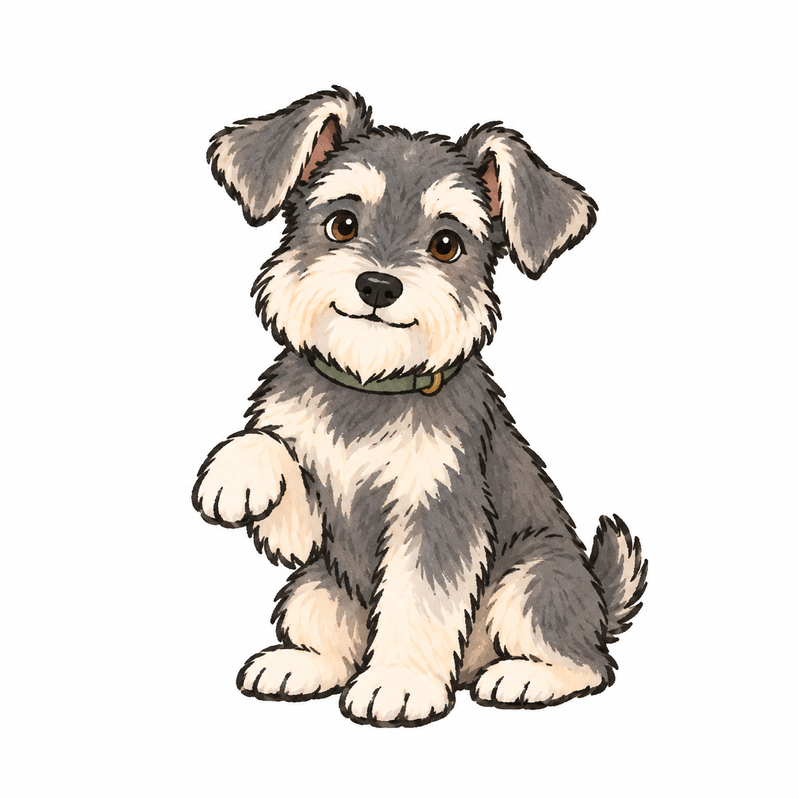
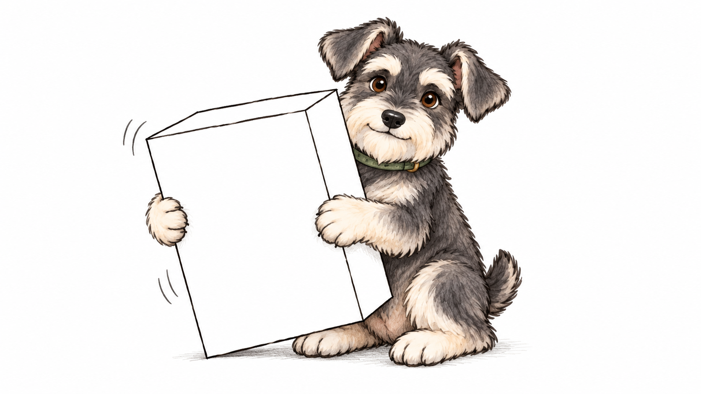

# dawn-pet

为 DawnVibe 生成保持角色一致的手绘配图。Dawn Pet 现为一只**灰白雪纳瑞**，支持头像、动作设定、正文场景、流程意境图和局部编辑。

[English](./README.md) · [MIT](./LICENSE)

<p align="center">
  
</p>

默认采用用户选定的简化手绘风：略抖黑色轮廓、灰白色块、少量毛发笔触、白底留白。每个动作都保持折耳、奶白眉胡、棕眼和带小黄铜扣的绿色项圈一致。

## 安装

GitHub 仓库与技能名称均为 **`dawn-pet`**。

```bash
npx skills add chenguang-jiang/dawn-pet --skill dawn-pet
```

从本地克隆安装到 Codex：

```bash
git clone https://github.com/chenguang-jiang/dawn-pet.git
mkdir -p ~/.codex/skills
ln -s "$PWD/dawn-pet/skills/dawn-pet" ~/.codex/skills/dawn-pet
```

从旧版迁移时，安装后移除旧的 `jcg-documentation-pet` 安装入口，避免同时发现两个版本。新技能在下一轮对话可用。

## 使用

```text
用 $dawn-pet 生成一张 16:9 白底配图：雪纳瑞认真抱住一个略大的箱子，
箱子有点歪。保持正式参考图里的角色身份，道具只用稀疏细黑线。
```

<p align="center">
  
</p>

抱箱子图是场景示例。抬爪图是**唯一正式身份与默认画风锚点**；后续场景采用它更简化的笔触。

## 支持的配图

| 请求 | 输出 |
|---|---|
| 头像或主视觉 | 白底单角色，轮廓清晰 |
| 动作设定图 | 最多三个分离姿势，同一只狗 |
| 正文场景 | 一个动作、一个主要道具，默认 16:9 |
| 流程或状态摘要 | 通常 3–5 个动作，细线箭头连接，节点下短标签 |
| 局部编辑 | 只修改点名部分，保留其余内容 |

技能读取锚点与身份规范，根据输入结构选择资产类型，组织 ImageGen 提示词并检查结果。它使用内置 ImageGen，不安装或训练图像模型。精确数值、字段、代码、复杂流程与并发时序交给 mermaid；狗狗插画可作为主线意境摘要。

## 文件与验证

入口为 [skills/dawn-pet/SKILL.md](./skills/dawn-pet/SKILL.md)。`references/` 包含身份、视觉系统、提示词、流程动作与验收规范；每次生成都要传入随技能附带的 PNG 锚点。

在仓库根目录验证：

```bash
python3 skills/dawn-pet/tests/test_skill_contract.py
```

[变更记录](./CHANGELOG.md) · [许可证](./LICENSE)
